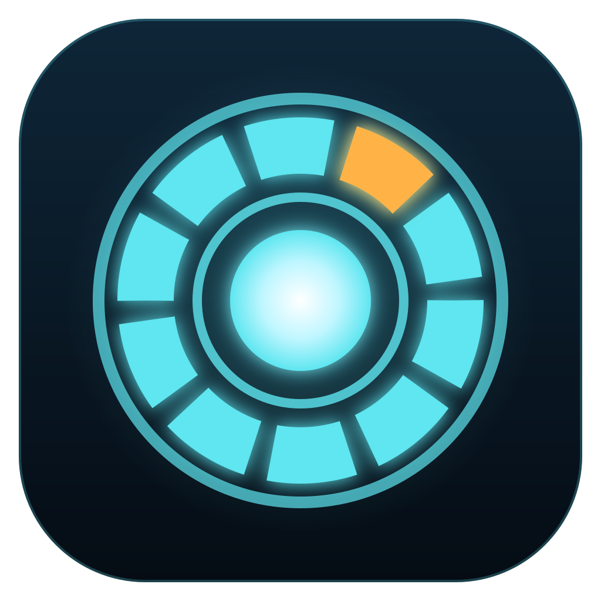

<p align="center">
  
</p>

<h1 align="center">JARVIS</h1>

A desktop cockpit for [Claude Code](https://claude.com/claude-code). Each workspace — an Obsidian vault or a code repo — gets its own force-graph and its own embedded Claude Code terminal. As Claude reads, searches and edits files, the matching nodes light up live: a real-time X-ray of what the AI is doing.

One extra session, the **main agent**, sits above the fleet. It can list every workspace, send work into their terminals, hear when they finish, keep your to-do list, and talk back to you.

## Features

- **Live highlight layer.** Reads leave a persistent ring and a trail of arrows in read order. Searches pulse, and the files a search matched glow for a few seconds. Edited files stay marked for the whole session.
- **Many workspaces.** A rail on the left switches between vaults and repos. Each has its own graph, terminal and status.
- **Mission control.** The home screen shows every workspace as a card with its status: running, waiting on you, or idle. `Ring` and `Fleet` give two other views of the same fleet.
- **2D and 3D graphs.** Vaults graph their `[[wikilinks]]`, Markdown links and tags. Code repos graph files and imports.
- **Session replay.** A scrubber rebuilds the highlight state at any earlier point of the current session.
- **Orchestrator.** The main agent drives the fleet through six MCP tools. See [MCP tools](#mcp-tools).
- **Voice (optional).** Say "Jarvis …" and the command is typed into the main agent's terminal. You still press Enter. Replies are read aloud, with a wireframe head and waveform.
- **Hand control (optional).** Webcam gestures pan, orbit, zoom and open panels. See [Gestures](#gestures).
- **Inbox.** A list at the top of the terminal panel with one row per workspace. Each row shows the status and the last message from Claude, or its current tool call while it runs. It is read-only: you reply in the terminal.
- **To-do list.** The main agent keeps your tasks in `TODO.md`, grouped by project. Double-click a task to read it in full, then edit or delete it. The main agent checks a task off only when you say it is done, not when a workspace reports it finished.
- **Daily briefing (optional).** On the first launch of the day, the main agent asks the Obsidian-valut workspace to summarise your newest daily note, project by project. See [Daily briefing](#daily-briefing).
- **Floating panels.** The terminal, preview, settings and to-do list are panels that you can drag, resize and collapse.

## How it works

JARVIS writes no AI logic of its own. It is a passive observer:

1. Before a terminal starts, JARVIS installs Claude Code hooks into that workspace's `.claude/settings.local.json`.
2. Each hook runs `src/hook/forward.mjs`, which POSTs the event JSON to a local listener on port `4599`.
3. The app maps each event to graph nodes (what lights up) and to a workspace status (what the session is doing).

The graph itself is static. It comes from the files on disk, never from search results.

## MCP tools

Only the main agent gets these tools. Delegate sessions never do, so a delegate cannot send work back up the chain.

| Tool            | What it does                                                                        |
| --------------- | ----------------------------------------------------------------------------------- |
| `jarvis_list`   | Lists every workspace with its status, current tool call and last message.          |
| `jarvis_send`   | Types a prompt into another workspace's live terminal and returns at once.          |
| `jarvis_launch` | Starts a Claude Code session for a workspace that has none, like its Launch button. |
| `jarvis_watch`  | Waits until another workspace finishes a turn, then returns its last message.       |
| `jarvis_say`    | Speaks a short summary aloud, up to 500 characters.                                 |
| `jarvis_todos`  | Opens your to-do list on screen and returns the file path to edit.                  |

The main agent does not need to poll. When a delegate finishes, JARVIS types a short nudge into the main agent's terminal so it can read the result.

## Graph sources

Each workspace uses the first source that matches:

| Source   | Detected by                                                            | Graph                                          |
| -------- | ---------------------------------------------------------------------- | ---------------------------------------------- |
| Vault    | a folder of Markdown notes                                             | notes, links and tags                          |
| GitNexus | a [GitNexus](https://www.npmjs.com/package/gitnexus) index in the repo | files and `IMPORTS` edges, plus a symbol level |
| Graphify | `graphify-out/graph.json`                                              | files and symbols by community                 |

A repo with no index shows a button that runs `npx gitnexus analyze` for you.

## Requirements

- Node.js 22 or newer
- [Claude Code](https://docs.claude.com/en/docs/claude-code) on your `PATH` as `claude`
- Windows 10/11 (primary target) or macOS
- Linux: `npm run make` builds `.deb` and `.rpm` packages, but nobody has tested them.
- Optional: `gitnexus` for code-repo graphs

## Getting started

```bash
git clone <this repo>
cd jarvis
npm install
npm run voice:assets   # only if you want voice
npm start
```

On first launch, JARVIS asks for your vault folder. Add code repos from the rail.

`npm run voice:assets` downloads the Whisper speech model (about 760 MB) and the ONNX runtime into `public/voice/`. The app's content security policy blocks fetching them at runtime, so they must be on disk first. Voice does not start without them.

## A first run

You run `npm start`. JARVIS asks for your Obsidian vault, and you pick it. The cockpit animates in: the workspace rail, then the mission-control cards, then a terminal. That terminal is the main agent, a Claude Code session that JARVIS starts for you.

You click **+** on the rail and add the repo you work on. JARVIS installs its hooks there and draws the repo's files as a graph. You open the repo and start its terminal.

Back on the home screen, you type to the main agent: _"Ask my-app to find why the login test fails."_ The main agent calls `jarvis_send`. The my-app card turns to **running**. You open my-app and watch Claude work: a search pulses across the graph, the matched files glow, and each file it reads gets a ring and an arrow from the one before.

When my-app goes idle, JARVIS nudges the main agent. The main agent reads that one result with `jarvis_watch` and sums it up in a sentence or two. JARVIS reads the first sentence of each paragraph aloud.

## Daily briefing

To turn it on, open settings and click **Choose** under **Daily notes**. Pick the folder where you keep your daily notes. **Clear** turns the briefing off.

The main agent resumes its last conversation each time JARVIS starts. On the first launch of a day, after 7:00, JARVIS also asks it for a briefing. The main agent does not read the note itself. It sends the newest `.md` file in that folder to the `Obsidian-valut` workspace with `jarvis_send`, and calls `jarvis_launch` first if that workspace has no session. Obsidian-valut writes a summary with one paragraph for each project the note mentions: what moved and what is still open. If the note is not from yesterday, it says which day it is from. You read that summary in Obsidian-valut's terminal or the inbox. When Obsidian-valut finishes, JARVIS wakes the main agent the normal way, and the main agent says its usual one or two sentences about it.

Some details:

- The briefing runs at most once a day. A launch before 7:00 skips it, and the next launch after 7:00 gives it.
- It needs an earlier main-agent conversation to resume, so the very first launch has no briefing.
- JARVIS waits for the main agent's terminal to go quiet before it asks. If the terminal stays busy for 60 seconds, that day is skipped.
- The first time, Claude Code in Obsidian-valut may ask your permission to read the notes folder.

## Gestures

Turn on the webcam with the ✋ button at the top right, or in settings. Gestures act on the view under the hand cursor. The Cards view takes no gestures.

| Gesture                                   | Action                                              |
| ----------------------------------------- | --------------------------------------------------- |
| Pinch and move                            | Pans the graph, or drags the panel you grab         |
| Two fingers up, flick left or right       | Steps to the previous or next item                  |
| Two fingers up, bend and straighten twice | Opens the item, like a double click                 |
| Open palm, roll the hand                  | Orbits the camera. It keeps spinning and slows down |
| Two open palms, move apart or together    | Zooms in or out                                     |
| Fist, hold 1 second                       | Pauses hand control. The camera stays on            |
| Open palm, hold 1 second                  | Turns hand control back on                          |

A click on the dashed ✋ button also turns hand control back on.

## Configuration

Copy `.env.example` to `.env`. Every value is optional.

| Variable             | Purpose                                                                                       |
| -------------------- | --------------------------------------------------------------------------------------------- |
| `ELEVENLABS_API_KEY` | Uses ElevenLabs for the spoken voice. Without it, speech falls back.                          |
| `VAULT_PATH`         | Skips the vault folder picker on first launch.                                                |
| `JARVIS_PORT`        | Hook listener port (default `4599`). The hook scripts read it from their own environment too. |

Settings, panel layout, workspace colours and the inbox are saved as JSON in Electron's `userData` folder. There is no database, and the event log is not saved.

## Scripts

| Command                | What it does                          |
| ---------------------- | ------------------------------------- |
| `npm start`            | Runs the app in development mode      |
| `npm run make`         | Builds installers into `out/make/`    |
| `npm test`             | Runs the Vitest suite                 |
| `npm run typecheck`    | Runs `tsc --noEmit`                   |
| `npm run lint`         | Runs ESLint                           |
| `npm run voice:assets` | Downloads the voice model and runtime |

A packaged build is about 680 MB. Almost all of it is the Whisper model.

## Project layout

```
src/
  main/      Electron main: hook listener, event and status mappers, graph sources,
             PTY manager, orchestrator, settings, text-to-speech
  renderer/  React UI: graph, home, terminal, preview, session replay, voice,
             hands, to-dos, and the panel shell
  shared/    Types shared by both processes
  hook/      Plain Node scripts that Claude Code runs: hook forwarder, installer,
             MCP server
tests/       Vitest suite, mirrors src/
```

## Privacy and caveats

- JARVIS writes its hooks into each workspace's `.claude/settings.local.json`, which Claude Code keeps out of git. To revert, delete the hook entries whose command runs `forward.mjs`, or delete the file if JARVIS created it.
- The hook listener binds to localhost only. Orchestrator routes require a custom header, so a web page cannot call them.
- Voice recognition runs locally. Nothing you say leaves the machine.
- Spoken replies try ElevenLabs first (if a key is set), then Microsoft Edge's read-aloud service, then the system voice. The Edge service is undocumented and not meant for third-party apps, so it can stop working at any time.

## License

[MIT](LICENSE)
